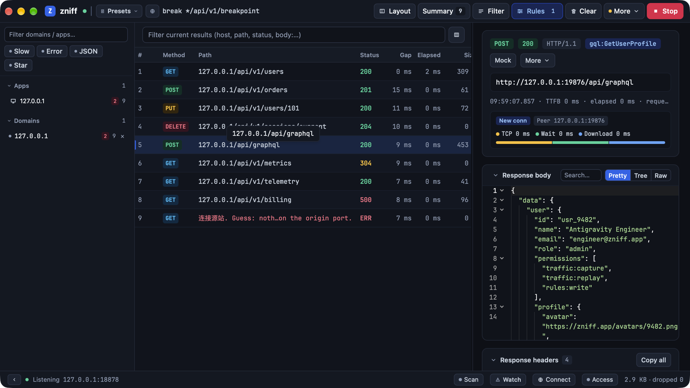
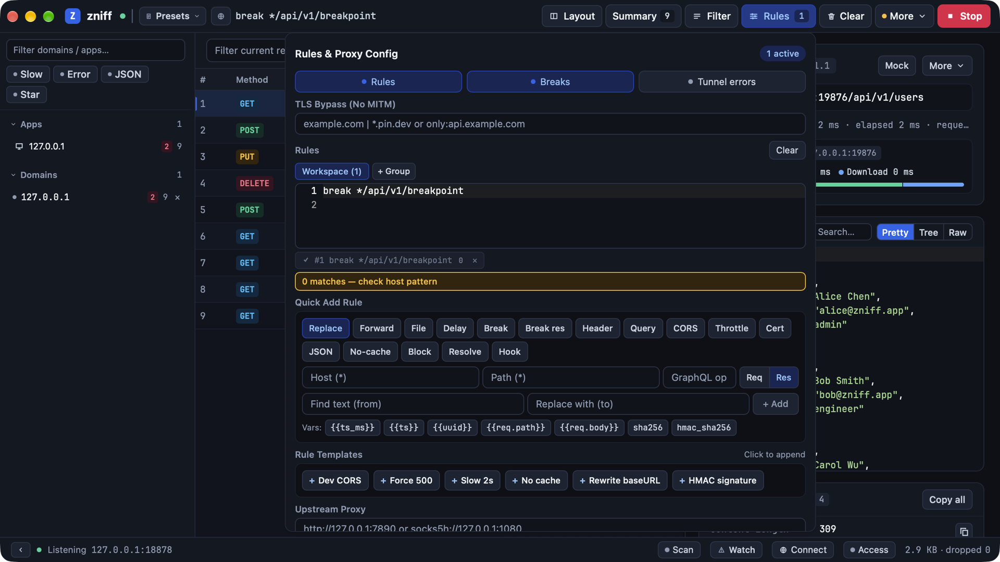
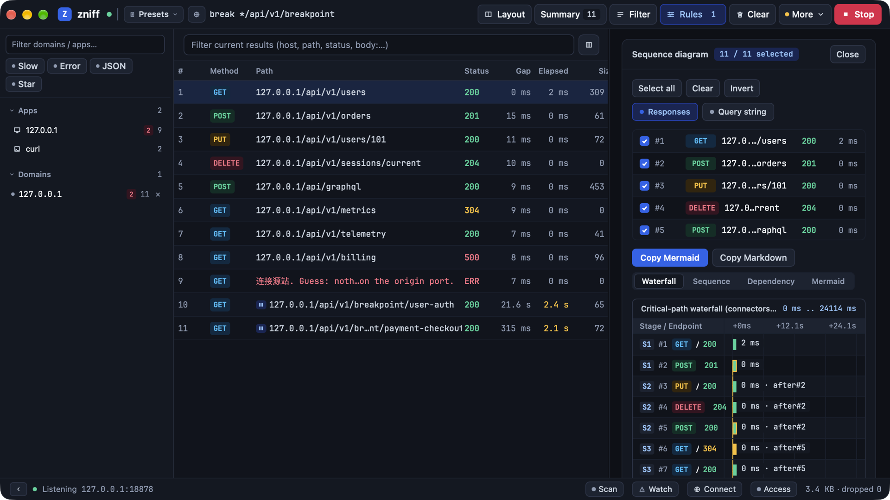
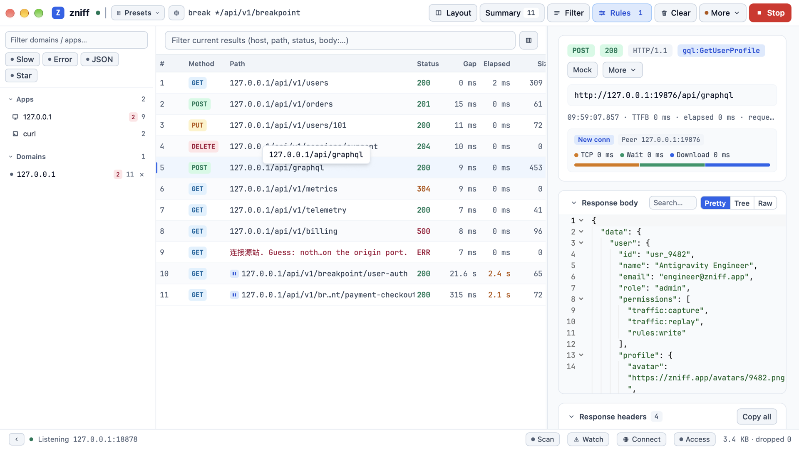

# zniff

<p align="center">
  <strong>基于纯 Rust 的单进程 HTTP(S) 抓包调试代理 — 集成原生 GUI、WebAssembly 操作台与内置 MCP 服务。</strong>
</p>

<p align="center">
  <a href="./README.md">English</a> | 简体中文
</p>

<p align="center">
  <a href="https://github.com/vicanso/zniff/releases"></a>
  <a href="https://www.rust-lang.org/"></a>
  <a href="./LICENSE"></a>
  <a href="#快速上手"></a>
  <a href="./docs/cli-web-mcp-zh.md"></a>
</p>

https://github.com/user-attachments/assets/19339425-f1df-47fe-ab8a-88bb586fd4a1

---

**zniff** 是一个轻量的 HTTP(S) 抓包调试代理，整体只是一个纯 Rust 二进制：代理内核与原生桌面界面跑在同一进程里，同一份界面还能编成 WebAssembly 网页操作台（`zniff --web`），内置的 MCP 服务让 AI 助手直接读取和操作抓包数据。内存有界（大正文自动落盘）；抓包无需改系统设置——一键拉起隔离浏览器、代理终端或通过 `adb` 接入 Android 设备；每条改写规则都是一行纯文本，易读、易比对、易分享。

## 核心亮点

- **免配抓包** — 底栏一个 **「接入」** 按钮即可拉起隔离 Chromium、代理终端、Android `adb`、iOS 模拟器、手机扫码，或开启按应用透明抓包（macOS 系统扩展 / Linux `aya` eBPF）。
- **真实协议** — 按 ALPN 跟随 HTTP/2、WebSocket 与 SSE，不降级 HTTP/1.1；支持 HTTP 与 SOCKS5 上游。
- **深度检视** — JSON 树、GraphQL、LLM / AI SSE 流、Protobuf、MessagePack、JWT 与基准对比。
- **纯文本规则** — 17 类规则（Mock、映射、改写、延迟、断点、Webhook…），支持多组叠加。
- **出错自救** — 失败流量直接给出 **加入直通**、**安装证书** 等一键修复。
- **图表与导出** — 瀑布图、时序图、依赖图；cURL / 多语言代码、OpenAPI、HAR、本地 Mock。
- **AI 原生** — 内置 MCP 服务（`zniff --mcp` / `POST /mcp`），提供 10 个工具。
- **平滑迁移** — 导入 Charles / Whistle 规则，复用本机已信任的根证书。

## 界面预览

| 深度检视（GraphQL 与 JSON） | 过滤与 17 类改写规则 |
| :---: | :---: |
|  |  |
| **瀑布图 / 时序图与断点栏** | **自适应浅色与深色主题** |
|  |  |

## 快速上手

### 安装

- **桌面端（macOS / Linux / Windows）**：从 [GitHub Releases](https://github.com/vicanso/zniff/releases) 下载——macOS 为已签名 Universal `.dmg`（及 `.tar.gz`），Linux 为 `.tar.gz`，Windows 为 `.zip`。用于 `--web`、`--relay`、`--mcp` 的独立无头命令行程序以 `zniff-cli-*` 同步发布。Homebrew / Scoop / Winget 清单模板见 [`packaging/`](./packaging/README.md)。
- **Linux（用户级安装脚本 [`scripts/install-linux.sh`](./scripts/install-linux.sh)）**：
  ```bash
  curl -fsSLO https://raw.githubusercontent.com/vicanso/zniff/main/scripts/install-linux.sh
  sh install-linux.sh
  ```
  无需 `root`，自动下载对应 `x86_64` / `aarch64` 发行包并通过 `SHA256SUMS` 校验（GitHub 不可达时自动回落 Gitee 镜像），检查 GTK 4.14+ / `glibc 2.39` 运行依赖，并将主程序、`zniff-ebpf-helper`、图标、启动器项与开机自启安装到 `~/.local` 和 `~/.config`（也可解压 Linux `.tar.gz` 后直接运行包内 `./install-linux.sh`）。支持 `--no-autostart`、`--ebpf-caps`、`--no-ebpf-caps`、`--tag vX.Y.Z` 与 `--uninstall`。
  - **Linux eBPF 透明代理**：需要 Linux 5.12+ 与 cgroup v2。默认在 **「接入」** 面板点击开启时通过 `pkexec` 弹窗授权；安装时加 `--ebpf-caps`（或在交互式安装确认提示中输入 `y`，或手动执行 `sudo setcap cap_bpf,cap_net_admin,cap_sys_resource+ep ~/.local/bin/zniff-ebpf-helper`）即可免密开启，原地更新替换 `zniff-ebpf-helper` 后需重新执行一次 `setcap`。
- **源码安装**：
  ```bash
  cargo install --git https://github.com/vicanso/zniff
  ```
- **Docker（Web 控制台）**：
  ```bash
  docker run --rm -p 8080:8080 -p 8877:8877 \
    -e ZNIFF_ALLOW_HOSTS="*.vicanso.dev" \
    -v "$PWD/zniff-data:/data" \
    vicanso/zniff-web:latest
  ```
  访问 `http://127.0.0.1:8080` 并点击「开始」。镜像默认拒绝所有域名，需显式放行——详见 [Docker 说明](./docs/cli-web-mcp-zh.md#docker)。

### 抓到第一个 HTTPS 请求

1. **启动** `zniff`——代理监听 `127.0.0.1:8877`。
2. **接入**——点击底栏 **「接入」**，拉起 `[浏览器]`（隔离 Chromium，免装证书）或 `[终端]`（预注入代理与 CA 环境变量）。暂时不想配代理？点击 **「加载示例流量」**。
3. **检视**——正常浏览或运行命令，解密后的请求实时出现在列表中，选中即可查看头、正文与耗时。

如需抓系统全局或移动端流量，请在 **更多 → 证书** 中信任根证书——详见 [客户端与根证书配置](./docs/guide-zh.md#客户端与根证书配置)。

## 了解更多

| 文档 | 内容 |
| :--- | :--- |
| [使用指南](./docs/guide-zh.md) | 功能导览、客户端与证书配置、Charles / Whistle 迁移、快捷键、数据目录、源码构建 |
| [规则与配置指南](./docs/rules-zh.md) | 过滤语法、TLS 直通、17 类规则、模板变量、规则组、配置预设 |
| [命令行、Web 控制台与 MCP](./docs/cli-web-mcp-zh.md) | `--web`、`--relay`、`--mcp`、Docker、安全控制、MCP 工具 |
| [文档索引](./docs/README.md) | 架构、已知限制、产品决策、演进规划 |

## 开源许可证

[Apache License, Version 2.0](./LICENSE)
