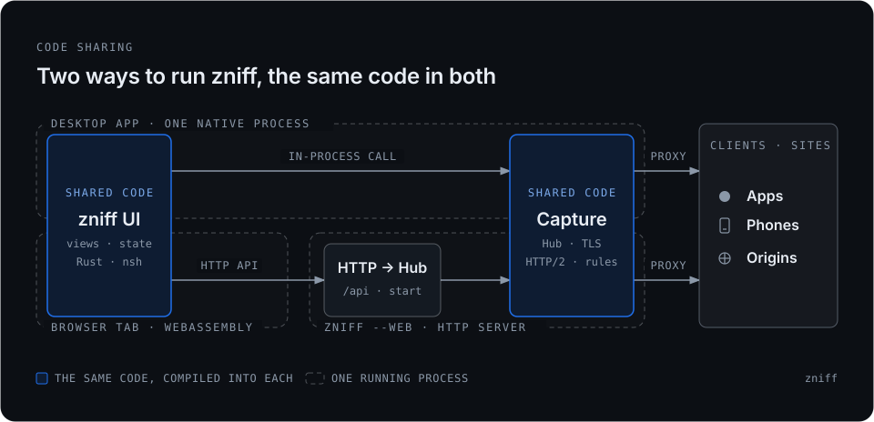

# zniff

[English](./README.md) | 简体中文

**zniff** 是一款使用 Rust 编写的轻量级 HTTP(S) 抓包与调试代理。桌面版把代理和原生界面（`nsh`）放在同一个进程里。同一份界面还会编成 WebAssembly，由 `zniff --web` 提供；抓包在这个服务器进程里完成。会话只在内存中，没有外部数据库。

---

## 桌面与网页



界面（`App`）和抓包层（`Hub`，加上 TLS、HTTP/2 和规则）各写一份，再分别编进桌面程序和网页程序。

| | 桌面 | 网页 |
| :--- | :--- | :--- |
| 界面 | 同一进程里的原生窗口 | 同一份 `App`，在浏览器里以 WebAssembly 运行 |
| 抓包 | 界面在进程内调用 `Hub` | 页面通过 `/api` 调用 `zniff --web` |
| 抓到谁 | 把本进程设为 HTTP 代理的客户端 | 同样的规则，发生在服务器上 |
| 系统代理与根证书 | 本机 | 留在桌面程序里 |

`make web` 在 `http://127.0.0.1:8080` 提供共用界面。页面负责操作。抓包在 `zniff --web` 进程里，而且只记录把该进程设为 HTTP 代理的客户端。抓包端口（开发配置里的 `listen_port`，否则是 `8877`）要点「开始」才打开。`zniff --web` 不改系统代理，也不读取桌面的 `capturing`。

改界面后运行 `make web-ui`，用 nsh 0.5 把页面重新打进 `app/.nsh/web`，再刷新浏览器。本机的 `nsh` 可能仍是 0.2；打包要用 0.5，且不要覆盖 `~/.nsh`。库测试仍走简易操作台，不加载 `app/.nsh/web`。

中继默认关闭。填了中继地址和密钥后，实时分享大约每秒推到那台主机。`zniff --relay --token <secret>` 只保存并提供 `/s/{id}`，自己不抓包。另一台 zniff 打开「接收中继」后，可以在自己的抓包端口上接收同样的上传。这些行可以查看、过滤、复制和星标。重放留在当初抓到流量的那台机器上。

---

## 核心特性

### 1. 协议跟随的 HTTP(S) 与 WebSocket 代理
- **协议跟随（HTTP/1.1 & HTTP/2）**：解析客户端 TLS `ClientHello` 中的 ALPN 列表并直接与源站握手，客户端与源站两侧严格使用源站选定的协议，不强制降级为 HTTP/1.1，不合并 `Cookie`，也不篡改业务请求头的大小写。
- **旁路解压与大体积 Body 环形落盘**：流量转发不等待界面渲染或解压记录。请求与响应正文在旁路按 `Content-Encoding`（`gzip`、`deflate`、`br`、`zstd`）反序解压并记录（单条上限 `1 MB`）。未星标请求完成后若正文超过 `16 KB`，会自动顺序追加写入系统临时目录 `zniff-spill/` 下的环形分片文件（单分片 `64 MB`，最多 8 个分片共 `512 MB`，Unix 下打开即 `unlink` 匿名化以保证进程强退后由内核自动回收），内存会话上限控制在 `256 MB`。
- **WebSocket 与 SSE 消息解析**：从旁路实时解析 WebSocket 帧（文本、二进制、Ping/Pong、Close），转发握手时自动剥离 `Sec-WebSocket-Extensions` 以避免压缩协商导致无法解析；对 `text/event-stream` 响应自动按 SSE 事件拆分展示。
- **直通名单与隧道回退**：支持按域名通配符（`*.example.com`）或白名单（`only:`）配置 TLS 直通（Bypass）；`ServerHello` 之前的握手失败自动回退为透明 TCP 隧道，不中断客户端正常访问。
- **上游代理串联**：支持配置 `upstream_proxy` 将流量转发至二级 HTTP/CONNECT 代理。

### 2. 高效列表与多维过滤语法
- **可定制表格列**：搜索框右侧列按钮与表头右键菜单按表格列顺序一对一控制：`序号`、`方法`、`路径`（可切换为完整 `URL`）、`状态`、`间隔`、`耗时`、`大小`、`协议`、`主机`、`来源 IP`。支持直接拖拽表头或在列设置面板中点击上移/下移按钮调整列顺序（支持一键恢复默认列序），可见的 `序号`、`方法`、`路径` 固定在左侧区域，其余列在右侧滚动区域横向滚动，所有列宽与列序持久化记忆，路径与主机支持开头/中间/结尾省略切换。
- **组合过滤表达式**：空格分隔多个 `AND` 条件，单个条件内支持用 `|` 或 `,` 表示 `OR`：
  - `host:api.example.com|*.cdn.com`（或 `domain:`）：多域名与泛域名匹配
  - `path:/v1|/auth`：多路径前缀匹配
  - `ip:127.0.0.1|192.168.1.10`（或 `client:`）：客户端来源 IP 匹配；`app:curl|node`（或 `proc:`）：本机回环连接的客户端进程名匹配
  - 方法精确匹配：`GET`、`POST`、`PUT`、`DELETE`、`CONNECT` 等
  - 状态码匹配：精确状态码（`200`、`404`）、状态段（`1xx`–`5xx`）或失败请求（`失败` / `fail` / `error` / `err`）
  - 类型匹配：`type:json`（或 `ct:html`、`ct:image` 等）
  - 内容搜索：`body:keyword`（搜索请求与响应正文）、`header:token`（搜索请求/响应头名与头值）、`note:keyword`（或 `comment:`，搜索流量备注，写 `note:` 筛选所有带备注流量）
  - 快捷标记：`pin:`（仅看星标）、`slow:`（耗时 ≥ 1 秒的慢请求）
  - 排除条件：`mute:ads.example.com` 或 `-keyword`（排除匹配的主机或路径）

### 3. 规则改写、断点调试与配置预设
> 详细语法说明与实战配置示例请参阅：**[规则与配置指南](./docs/rules-zh.md)**（[English Guide](./docs/rules.md)）

- **终点规则**（按文本顺序第一条命中生效）：
  - `map-local <匹配模式> [<本地文件路径>] [status=200]` — 直接用本地文件（或仅指定 `status=` 的空正文）响应，不连接源站；也支持在列表右键或详情「更多」中点击「本地映射」一键另存响应并生成规则。
  - `map-remote <匹配模式> <https://目标主机/路径>` — 将请求转发至新的目标地址。
  - `break <匹配模式>` — 在请求发往源站前暂停，可实时修改方法、URL、请求头与请求正文后放行或丢弃。
  - `break-res <匹配模式>` — 在响应返回客户端前暂停，可实时修改状态码、响应头与响应正文后放行。
- **叠加修饰规则**（所有命中项叠加生效）：
  - `replace <匹配模式> req|res <原文> -> <替换为>` — 替换请求路径/查询串/正文或 UTF-8 响应正文（支持用双引号 `"..."` 包裹含空格文本）。
  - `delay <匹配模式> <ms|s>` — 注入最高 30 秒的请求延迟。
  - `header <匹配模式> req|res set|del <HeaderName> [<Value>]` — 增删改请求头或响应头。
  - `query <匹配模式> set|del <参数名> [<参数值>]` — 自动增删改请求 URL 查询参数。
  - `cors <匹配模式>` — 自动补齐跨域响应头，并对无终点规则的 `OPTIONS` 预检请求直接返回 `204`。
- **配置预设（`SavedProfile`）**：顶栏「过滤」双栏面板支持将过滤条件、直通名单、规则文本、上游代理与开关状态保存为命名配置（最多 16 条），支持一键导出 `.toml` 到剪贴板，或展开多行输入框粘贴 `.toml` 文本（及拖拽 `.toml` 文件）导入。

### 4. 详情检视、基准对比与编辑重发
- **多视图正文展示**：
  - JSON、HTML、XML 及多行文本在带行号与代码折叠的只读编辑器中高亮展示，请求/响应 Body 卡片标题栏内置关键词搜索框与匹配计数过滤。
  - 美化模式下支持 **GraphQL** 查询与变量分块格式化、**Protobuf / gRPC** 无 Schema Wire Tag 解码视图、以及 **MessagePack** 自动转译 JSON 预览。
  - 对 HTML 与 Markdown 正文提供「预览 / 美化 / 原文」三态切换，通过 `text_view` 直接渲染富文本结构。
  - 图片响应（`png`、`jpeg`、`webp`、`gif`）在美化模式下直接按原图比例预览并标注尺寸与字节数。
  - 二进制正文提供带行号的 16 字节 / 32 字节自适应宽度十六进制视图。
  - 请求头、查询参数与表单字段（支持 `application/x-www-form-urlencoded` 与 `multipart/form-data` 分片结构化表格）中的 **JWT**、10/13 位**时间戳**与可打印 **Base64** 自动在原值下方展示解码提示。
- **流量备注与仅清空未星标**：支持为任意流量添加备注（显示在列表路径列与详情摘要中，HAR 1.2 导入导出自动读写 `comment` 字段），并在顶栏「更多」菜单支持「清空未星标」以保留星标请求。
- **行级基准对比（Diff）**：将任意一条流量设为「基准」（红竖线标记），选中另一条流量即可在「对比」卡片中上下对照两者的 URL、请求头、请求正文、响应头与响应正文差异。
- **当前列表聚合统计与调用时序图生成（Sequence Diagram）**：未选中流量时（或在详情摘要点击「统计」按钮 / 按 `Esc` 键返回），右栏顶部展示「当前列表统计」卡片，实时汇总当前筛选结果的总请求数、总流量（含上下行拆分）、平均耗时、状态码分布（`2xx` / `3xx` / `4xx` / `5xx` / `ERR`）以及可点击跳转的「最慢请求」；在统计卡片右上角或顶栏「更多」菜单点击「生成时序图」可载入当前筛选列表（默认全选，支持逐条勾选/取消、全选/全不选/反选，以及切换「含响应」与「含查询参数」），一键生成包含客户端与多源站交互、状态码、耗时及备注 Note 的 Mermaid `sequenceDiagram` 时序图并支持复制 Mermaid 原文或 Markdown 代码块。
- **重放、批量重放、编辑重发与独立构造请求**：支持一键重放（`Cmd/Ctrl+R`）、内联「批量重放…」（指定重放次数 `1..=100`、间隔毫秒数及 `5×` / `10×` / `20×` 快捷预设）、基于选中流量「编辑重发」，或在未选中流量时直接点击「构造请求」（右栏空态按钮或顶栏「更多」菜单）从零构造请求；在 URL 输入框中直接粘贴 `curl ...` 命令可自动解析并回填各字段。
- **多格式复制**：支持复制 URL、`cURL`、`fetch`、Python `requests`、响应 JSON 的浅层 TypeScript `interface`、请求原文与响应原文，以及一键复制终端代理环境变量（覆盖 `http_proxy`、`all_proxy`、`SSL_CERT_FILE`、`NODE_EXTRA_CA_CERTS`、`REQUESTS_CA_BUNDLE`、`CURL_CA_BUNDLE`、`GIT_SSL_CAINFO`、`CARGO_HTTP_CAINFO`、`DENO_CERT`、`JAVA_TOOL_OPTIONS`）。

### 5. 手机扫码抓包、HAR 与实时网页分享
- **系统代理与根证书信任诊断**：自动生成 `zniff CA` 根证书，支持在「更多」菜单中一键安装、信任或移除证书（支持 macOS 登录钥匙串、Windows 当前用户 Root 存储、Linux `~/.pki/nssdb`），并在 macOS 下结合 `security verify-cert` 精确诊断「证书：已信任」「证书：未开启信任」与「证书：未安装」。系统代理修改前会将原配置独立备份至 `proxy-snapshot.toml`，即使进程异常退出，下次启动时也会自动恢复系统代理。
- **局域网监听与手机扫码装证**：打开底栏「局域网」开关绑定 `0.0.0.0` 后，点击「扫码」即可生成指向 `http://<局域网IP>:<端口>/zniff` 的二维码，手机扫码即可下载安装根证书并查看 iOS / Android 配置引导。
- **HAR 1.2 与 HTML 导出**：支持导入 `.har` 文件（菜单选择或直接拖拽到窗口），以及将当前筛选流量导出为 `.har` 或单文件离线 `.html` 快照。
- **实时网页分享**：支持生成 15 分钟、1 小时或 8 小时有效期的只读分享链接 `http://<地址>:<端口>/s/<uuid>`，网页端每 2 秒增量拉取新流量，并在点击条目时按需加载落盘的大体积正文。

---

## 快捷键

| 快捷键 | 功能 |
| :--- | :--- |
| `↑` / `↓` | 在当前筛选后的列表中切换上一条 / 下一条流量 |
| `Cmd/Ctrl + F` | 聚焦左侧过滤搜索框 |
| `Cmd/Ctrl + K` | 清空当前整个抓包会话 |
| `Cmd/Ctrl + R` | 重放当前选中的流量 |

---

## 配置文件与数据目录

用户配置保存在 `config.toml`，系统代理现场快照保存在 `proxy-snapshot.toml`：

- **macOS**：`~/Library/Application Support/zniff`
- **Windows**：`%APPDATA%\zniff`
- **Linux**：`$XDG_DATA_HOME/zniff` 或 `~/.local/share/zniff`

> **开发与正式环境隔离**：在 Debug 构建或设置环境变量 `ZNIFF_DEV=1`（如执行 `make dev`）时，程序会读写独立的 `config.dev.toml`（默认端口 `8878`）与 `proxy-snapshot.dev.toml`，与正式版 `config.toml`（默认端口 `8877`）互不干扰，同时共用 `ca.crt` 与 `ca.key` 根证书。

---

## 开发与构建命令

在仓库根目录下执行（`app/` 为唯一的 crate 与 workspace）：

```bash
# 桌面窗口。bacon 保持终端附着。开发配置，默认端口 8878
make dev

# 共用界面：http://127.0.0.1:8080。抓包端口要点开始才打开
make web

# 改界面后用 nsh 0.5 重新打包 app/.nsh/web
make web-ui

# 额外参数，例如换网页端口
make web ARGS="--web-port 8090"

# 编译 Debug 二进制
make build

# 代码格式化、Clippy 静态检查（拒绝任何警告）与单元测试
make fmt
make lint
make test

# 编译 Release 二进制
make release

# 打包 macOS 应用程序束（zniff.app）
make bundle
```

每日镜像是 [`vicanso/zniff-web:nightly`](https://hub.docker.com/r/vicanso/zniff-web)（linux/amd64 与 linux/arm64）。正式版标签还会发布 `vicanso/zniff-web:<version>` 和 `latest`。镜像里的页面是简易操作台。把 `make web-ui` 打出的目录挂到 `/web` 启用共用界面，把宿主机目录挂到 `/data`（镜像内默认 `ZNIFF_DATA_DIR=/data`）即可在容器重启后复用生成的根证书 `ca.crt`/`ca.key` 与 `config.toml`（可选 `ZNIFF_PROXY_AUTH` 或 `--proxy-auth` 为抓包端口开启 HTTP Basic 认证）：

```bash
docker pull vicanso/zniff-web:nightly
docker run --rm -p 8080:8080 -p 8877:8877 -v "$PWD/zniff-data:/data" vicanso/zniff-web:nightly

docker run --rm -p 8080:8080 -p 8877:8877 \
  -e ZNIFF_WEB_ROOT=/web \
  -e ZNIFF_PROXY_AUTH=user:pass \
  -v "$PWD/app/.nsh/web:/web:ro" \
  -v "$PWD/zniff-data:/data" \
  vicanso/zniff-web:nightly
```

本地构建用 `docker build -t zniff .`。入口是 `zniff --web --web-bind 0.0.0.0 --bind 0.0.0.0 --port 8877`。抓包端口仍要点「开始」才打开。不要把 `8080` 和 `8877` 暴露到公网：页面上能看到正文和 Cookie。推送需要 `DOCKER_HUB_USERNAME` 和 `DOCKER_HUB_ACCESS_TOKEN`；没有这两项时 CI 仍会构建镜像，只是不推送。

关于各平台能力边界与已接受的设计取舍，请参考 [docs/known-issues.md](./docs/known-issues.md)。

---

## 开源许可

本项目基于 [Apache License 2.0](./LICENSE) 许可开源。
