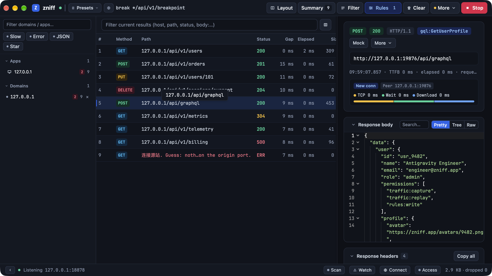
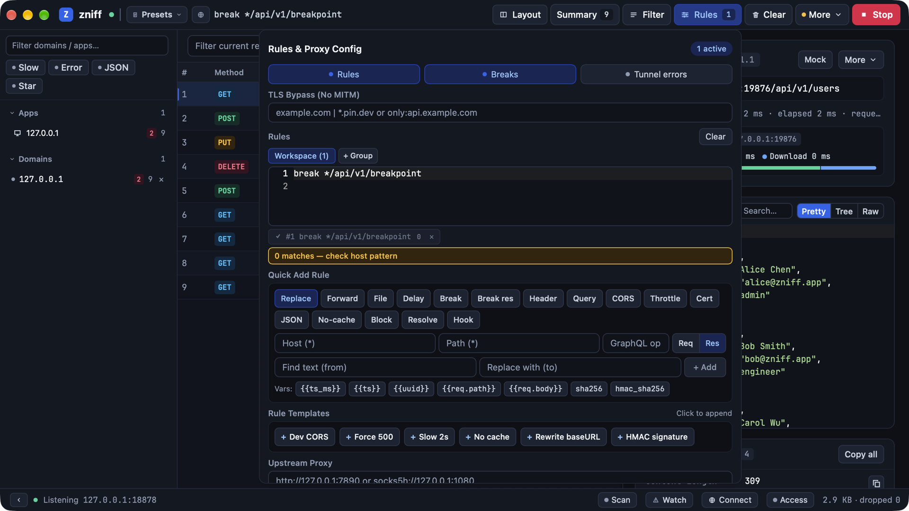
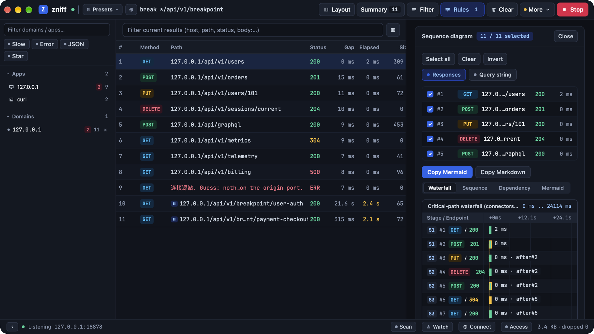
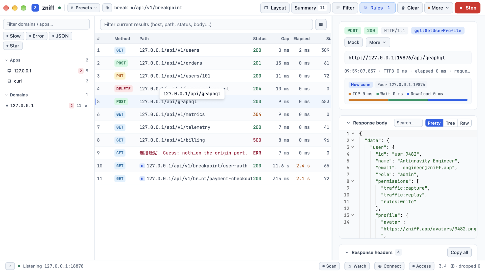

# zniff

<p align="center">
  <strong>Single-process HTTP(S) debugging proxy in pure Rust — native GUI, WebAssembly console, and built-in MCP server.</strong>
</p>

<p align="center">
  English | <a href="./README-zh.md">简体中文</a>
</p>

<p align="center">
  <a href="https://github.com/vicanso/zniff/releases"></a>
  <a href="https://www.rust-lang.org/"></a>
  <a href="./LICENSE"></a>
  <a href="#quick-start"></a>
  <a href="./docs/cli-web-mcp.md"></a>
</p>

https://github.com/user-attachments/assets/19339425-f1df-47fe-ab8a-88bb586fd4a1

---

**zniff** is a lightweight HTTP(S) debugging proxy built as one pure-Rust binary: the proxy engine and a native desktop GUI run in the same process, the very same UI ships as a WebAssembly web console (`zniff --web`), and a built-in MCP server lets AI assistants read and drive your captures. Memory stays bounded (large bodies spill to disk), capture needs zero system setup — launch an isolated browser, a proxied terminal, or an Android device over `adb` in one click — and every rewrite rule is a plain-text line you can read, diff, and share.

## Highlights

- **Zero-config capture** — isolated Chromium, proxied terminal, Android `adb`, iOS Simulator, phone QR, or per-app transparent proxy (macOS System Extension / Linux `aya` eBPF) from one **Connect** button.
- **Real protocols** — follows ALPN for HTTP/2, WebSocket, and SSE without HTTP/1.1 downgrades; HTTP and SOCKS5 upstreams.
- **Deep inspection** — JSON tree, GraphQL, LLM / AI SSE streams, Protobuf, MessagePack, JWT, and baseline diffs.
- **Plain-text rules** — 17 rule types (mock, map, rewrite, delay, breakpoints, webhooks…) in stackable groups.
- **Self-healing errors** — failed flows offer one-click fixes such as **Bypass TLS** or **Install CA**.
- **Diagrams & exports** — waterfall, sequence, and dependency diagrams; cURL / code snippets, OpenAPI, HAR, local mocks.
- **AI-native** — built-in MCP server (`zniff --mcp` / `POST /mcp`) with 10 tools.
- **Easy migration** — import Charles / Whistle rules and reuse an already-trusted root CA.

## Screenshots

| Deep Inspection (GraphQL & JSON) | Filters & 17 Rewrite Rules |
| :---: | :---: |
|  |  |
| **Waterfall / Sequence Diagrams & Breakpoints** | **Adaptive Light & Dark Mode** |
|  |  |

## Quick Start

### Install

- **Desktop (macOS / Linux / Windows)**: download from [GitHub Releases](https://github.com/vicanso/zniff/releases) — signed universal `.dmg` (and `.tar.gz`) for macOS, `.tar.gz` for Linux, and `.zip` for Windows. macOS/Windows desktop binaries also support `--web`, `--relay`, and `--mcp` directly, while standalone Linux headless CLI binaries (`zniff-cli-linux-*`) are published alongside for server environments without desktop libraries. Homebrew / Scoop / Winget templates live in [`packaging/`](./packaging/README.md).
- **Linux (user-level install via [`scripts/install-linux.sh`](./scripts/install-linux.sh))**:
  ```bash
  curl -fsSLO https://raw.githubusercontent.com/vicanso/zniff/main/scripts/install-linux.sh
  sh install-linux.sh
  ```
  Downloads the matching `x86_64` / `aarch64` release (verified with `SHA256SUMS`, falling back to Gitee if GitHub is unreachable), checks GTK 4.14+ / `glibc 2.39` dependencies, and installs the binary, `zniff-ebpf-helper`, icon, desktop entry, and autostart under `~/.local` and `~/.config` without root (or run `./install-linux.sh` from an unpacked Linux `.tar.gz`). Supports `--no-autostart`, `--ebpf-caps`, `--no-ebpf-caps`, `--tag vX.Y.Z`, and `--uninstall`.
  - **Linux eBPF transparent proxy**: requires Linux 5.12+ and cgroup v2. Starting it from the **Connect** popover prompts via `pkexec` by default; pass `--ebpf-caps` during install (or confirm the prompt / run `sudo setcap cap_bpf,cap_net_admin,cap_sys_resource+ep ~/.local/bin/zniff-ebpf-helper`) for passwordless start, and re-run `setcap` after upgrading `zniff-ebpf-helper`.
- **From source**:
  ```bash
  cargo install --git https://github.com/vicanso/zniff
  ```
- **Docker (Web console)**:
  ```bash
  docker run --rm -p 8080:8080 -p 8877:8877 \
    -e ZNIFF_ALLOW_HOSTS="*.vicanso.dev" \
    -v "$PWD/zniff-data:/data" \
    vicanso/zniff-web:latest
  ```
  Open `http://127.0.0.1:8080` and click **Start**. The image denies all hosts until allowed — see [Docker details](./docs/cli-web-mcp.md#docker).

### Capture your first HTTPS request

1. **Start** `zniff` — the proxy listens on `127.0.0.1:8877`.
2. **Connect** — click **Connect** in the footer and launch `[Browser]` (isolated Chromium, no certificate install) or `[Term]` (proxy & CA env vars pre-set). No proxy yet? Click **Load Sample Traffic**.
3. **Inspect** — browse or run your command; decrypted requests stream into the list. Select one to see headers, bodies, and timing.

For system-wide or mobile capture, trust the root CA via **More → Certificate** — see [Client & Root CA setup](./docs/guide.md#client--root-ca-setup).

## Learn More

| Guide | What's inside |
| :--- | :--- |
| [User Guide](./docs/guide.md) | Feature tour, client & CA setup, Charles / Whistle migration, shortcuts, data directory, building from source |
| [Rules & Configuration](./docs/rules.md) | Filter syntax, TLS bypass, all 17 rule types, templates, rule groups, saved setups |
| [CLI, Web Console & MCP](./docs/cli-web-mcp.md) | `--web`, `--relay`, `--mcp`, Docker, access control, MCP tools |
| [Documentation Index](./docs/README.md) | Architecture, known issues, design decisions, roadmaps |

## License

[Apache License, Version 2.0](./LICENSE)
