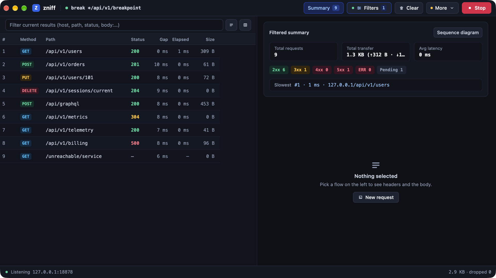

# zniff

<p align="center">
  <strong>Ultra-fast, single-process HTTP(S) debugging proxy written in Rust with native GUI, WebAssembly console, and AI-native MCP integration.</strong>
</p>

<p align="center">
  English | <a href="./README-zh.md">简体中文</a>
</p>

<p align="center">
  <a href="https://github.com/vicanso/zniff/releases"></a>
  <a href="https://www.rust-lang.org/"></a>
  <a href="./LICENSE"></a>
  <a href="#quick-start"></a>
  <a href="#why-zniff"></a>
  <a href="#9-ai-native-mcp-server-integration"></a>
</p>

---

<p align="center">
  
</p>

---

## Table of Contents

- [Why zniff?](#why-zniff)
- [Comparison Matrix](#comparison-matrix)
- [Quick Start](#quick-start)
- [Visual Feature Deep-Dive](#visual-feature-deep-dive)
  - [1. Dual-Pane Traffic Table, Customization & Facets](#1-dual-pane-traffic-table-customization--facets)
  - [2. Deep Inspection: JSON/GraphQL & Inline Search](#2-deep-inspection-jsongraphql--inline-search)
  - [3. Binary Decoders: Schema-less Protobuf/gRPC & Hex Dump](#3-binary-decoders-schema-less-protobufgrpc--hex-dump)
  - [4. Baseline Comparison & Line-by-Line Diff](#4-baseline-comparison--line-by-line-diff)
  - [5. 14 Quick-Add Rewrite Rules & Validated DSL](#5-14-quick-add-rewrite-rules--validated-dsl)
  - [6. Breakpoint Interception & Concurrency Queue](#6-breakpoint-interception--concurrency-queue)
  - [7. Interactive Sequence, Waterfall & Dependency Diagrams](#7-interactive-sequence-waterfall--dependency-diagrams)
  - [8. Mobile Inspection, QR Code & iOS Simulator Auto-Trust](#8-mobile-inspection-qr-code--ios-simulator-auto-trust)
  - [9. AI-Native MCP Server Integration](#9-ai-native-mcp-server-integration)
  - [10. Adaptive Dark/Light Mode](#10-adaptive-darklight-mode)
- [Rule DSL Quick Reference](#rule-dsl-quick-reference)
- [CLI Flags & Operating Modes](#cli-flags--operating-modes)
- [Keyboard Shortcuts](#keyboard-shortcuts)
- [Configuration & Storage](#configuration--storage)
- [Development & Build](#development--build)
- [License](#license)

---

## Why zniff?

Most HTTP(S) debugging proxies are bloated Electron shells, legacy Java runtimes, or complex multi-process systems with heavy background services. **zniff** takes a radical approach: a high-performance proxy engine and a responsive native GUI written in **pure Rust**, compiled into a **single self-contained binary**.

- ⚡ **Blazing Fast Native Performance**: Boots in **< 30 ms** and idles at **< 25 MB RAM**. The desktop app pairs the proxy core with a native GUI (`nsh`) in the exact same process. Zero Electron, zero JVM, zero web bloat.
- 🤖 **AI-Native Model Context Protocol (MCP)**: Built-in JSON-RPC 2.0 MCP server available via loopback HTTP `POST /mcp` and stdio bridge `zniff --mcp`. Seamlessly integrates with **Claude Desktop**, **Cursor**, and autonomous AI agents to query flows, inspect payloads, replay requests, and modify rewrite rules programmatically.
- 🌐 **True Protocol Following (Zero Downgrade)**: Reads the client's TLS `ClientHello` ALPN offers and negotiates directly with origins. Real HTTP/2 multiplexing, RFC 6455 WebSocket frame sniffing, and SSE parsing without downgrading to HTTP/1.1, scrambling headers, or forcing chunked transfer.
- 🛡️ **Bounded Memory & Transparent Disk Spill**: Strict 256 MB in-memory session cap. Completed unpinned flow bodies larger than 16 KB automatically spill to an anonymous rotating ring buffer on disk (`zniff-spill/`, up to 512 MB across 8 segments). Anonymous unlinking on Unix guarantees instant garbage collection on exit without memory leaks. Pin up to 32 vital flows that are exempt from eviction.
- 🎯 **14 Traffic Rewrite Rules & GraphQL `op=` Targeting**: Features 14 distinct rule templates spanning terminal rules (`map-local`, `map-remote`, `break`, `break-res`, `block`) and additive modifiers (`replace`, `json` pointer, `delay`, `throttle`, `header`, `query`, `cors`, `no-cache`, `cert`/`mtls`). 11 rules support `op=<GraphQL operation>` matching with wildcards and OR syntax for surgical precision.
- 📊 **Interactive 4-View Sequence & Waterfall Diagrams**: Transform traffic flows into actionable insights: 1) Waterfall Gantt timeline (DNS, TCP, TLS, TTFB, download), 2) Swimlane sequence diagram, 3) Dependency flowchart (`flowchart TD`), and 4) Mermaid source editor with copy-to-clipboard actions.

---

## Comparison Matrix

| Feature / Dimension | zniff | Proxyman | Charles | mitmproxy |
| :--- | :---: | :---: | :---: | :---: |
| **Startup Time** | **< 30 ms** | ~1–2 s | ~5–10 s | ~1 s |
| **Idle Memory Footprint** | **~25–50 MB** | ~150–300 MB | ~500 MB–1.2 GB | ~100–200 MB |
| **Architecture** | **Single-process Rust** | Native Swift (macOS) / Electron (Win) | Java JVM runtime | Python runtime |
| **HTTP/2 Multiplexing** | **Native ALPN following** | Supported | Demuxed / H1 downgrade | Supported |
| **Built-in AI MCP Server** | **Native (`POST /mcp` & stdio)** | ❌ No | ❌ No | ❌ External plugin only |
| **WebAssembly Console** | **Included (`zniff --web`)** | ❌ No | ❌ No | Python Web UI |
| **Traffic Rules Engine** | **14 rules + GraphQL `op=`** | Scripting / Map Local | Rewrite / Map Local | Python Addons |
| **Disk Spill Protection** | **Automatic ring spill (>16KB)** | Custom cache | Disk buffer | Stream memory cap |
| **Open Source / License** | **Open Source (Apache 2.0)** | Proprietary ($69–$99) | Proprietary ($50) | Open Source (MIT) |

---

## Quick Start

### 1. Installation

#### macOS
```bash
# Via pre-built .app bundle or Homebrew:
brew install zniff

# Or build from source:
git clone https://github.com/vicanso/zniff.git
cd zniff
make bundle   # Creates zniff.app in target/release/bundle/osx/
```

#### Linux & Windows
Download pre-built standalone binaries from [GitHub Releases](https://github.com/vicanso/zniff/releases) or compile with Cargo:
```bash
cargo install --path app
```

#### Docker (Web Console)
Run the headless web console with on-demand capturing:
```bash
docker run --rm -p 8080:8080 -p 8877:8877 \
  -v "$PWD/zniff-data:/data" \
  vicanso/zniff-web:nightly
```
Access the operator console at `http://127.0.0.1:8080`. The capture port `8877` opens when you click **Start**.

---

### 2. Configure Your Client (5 Seconds)

1. Launch `zniff`. The proxy engine binds to `127.0.0.1:8877` by default.
2. In the top toolbar **More** menu, click **Copy Proxy Env** and paste it into your terminal:
   ```bash
   export HTTP_PROXY="http://127.0.0.1:8877"
   export HTTPS_PROXY="http://127.0.0.1:8877"
   export ALL_PROXY="http://127.0.0.1:8877"
   export SSL_CERT_FILE="$HOME/Library/Application Support/zniff/ca.crt"
   ```
3. **HTTPS Decryption (Root CA)**:
   - **macOS**: Click **More** → **Certificate: Not Installed** → **Install** to add and trust `zniff CA` in Keychain.
   - **iOS Simulator**: Click **Install CA to iOS Simulators** in the More menu to trust the cert and set the proxy across all booted simulators via `xcrun simctl`.
   - **Mobile Devices**: Click **QR** in the footer to display the setup QR code, or navigate to `http://<lan-ip>:8877/zniff` on your mobile browser.

---

## Visual Feature Deep-Dive

All screenshots below are captured from live `zniff` sessions at uniform `1920 x 1080` (Full HD 16:9).

### 1. Dual-Pane Traffic Table, Customization & Facets

<p align="center">
  
</p>

- **Dual-Pane Layout**: Resizable split (280–1100 px) with live constraint preserving detail space. The left fixed zone pins `#` (ID), `Method`, and `Path` during horizontal scrolling.
- **10 Toggleable Columns**: `#`, `Method`, `Path` (toggleable to full URL), `Status`, `Gap` (time delta since previous visible flow, hover for timestamp), `Elapsed` (colored warning on flows ≥ 1s), `Size`, `Protocol`, `Host`, and `Client IP` (with automatic loopback process identification, e.g., `127.0.0.1 (curl)`).
- **Three-State Header Sorting**: Click any header to cycle through Ascending (`↑`), Descending (`↓`), or arrival order.
- **Collapsible Facets Drawer**: Aggregates traffic counts and error rates by domain (`host:`) and local client process (`app:` / `proc:`). Click any pill to toggle filters; click `×` to mute.

---

### 2. Deep Inspection: JSON/GraphQL & Inline Search

<p align="center">
  
</p>

- **GraphQL First-Class Citizen**: Automatically formats GraphQL requests, cleanly separating `operationName`, query/mutation document, and variable payloads.
- **Inline Search & Hit Counter**: Built-in case-insensitive search bar in request and response body cards. Jump directly to matching lines with line-number indicators (`[L0001]`).
- **Smart Decoders**: Automatic inline decoding for **JWT** tokens, Unix **timestamps** (10-digit and 13-digit), and printable **Base64** strings directly under headers, query parameters, and form fields.

---

### 3. Binary Decoders: Schema-less Protobuf/gRPC & Hex Dump

<p align="center">
  
</p>

- **Schema-less Protobuf & gRPC**: Decodes binary wire tags (`field #N (varint/string/32-bit/64-bit)`), strips gRPC 5-byte length headers, and recurses into nested sub-messages without requiring `.proto` definition files.
- **MessagePack to JSON**: Automatically deserializes MessagePack payloads into formatted JSON trees.
- **Responsive Hex Viewer**: 16-byte or 32-byte adaptive layout with 4-digit hexadecimal line offsets and ASCII side representation.

---

### 4. Baseline Comparison & Line-by-Line Diff

<p align="center">
  
</p>

- **One-Click Baseline**: Right-click any flow or use the More menu to designate it as the **Baseline** (highlighted with a distinctive red bar).
- **Side-by-Side Diff View**: Select any other flow (marked with a green bar) to inspect line-by-line differences across URL, request headers, request body, response headers, and response body with color-coded diff markers.

---

### 5. 14 Quick-Add Rewrite Rules & Validated DSL

<p align="center">
  
</p>

- **Dual-Column Configuration Modal**: Top toolbar **Filters** popover with synchronized filter expression tokens on the left, and 14 quick-add rule tabs on the right.
- **Real-Time Validation**: Instant line-by-line syntax checking with red indicators highlighting erroneous rule syntax before saving.
- **Profile Presets & Undo Snapshots**: Save up to 16 complete named configurations (`SavedProfile`). One-click export to clipboard as `.toml`, import via drag-and-drop, and rollback with the 10-step configuration history stack.

---

### 6. Breakpoint Interception & Concurrency Queue

<p align="center">
  
</p>

- **Bounded FIFO Queue (8 Slots)**: Prevents client connection starvation and proxy deadlocks. The 9th arriving breakpoint automatically releases the oldest head flow.
- **Interactive Capsule Navigation**: Jump between concurrent paused flows using `#id` pills in the top breakpoint bar.
- **Live Compose & Actions**: Modify method, URL, headers, and body before sending. Support for **Continue** (`放行`), **Continue all** (`全部放行`), or **Drop** (`丢弃`, closing the client connection cleanly with status `ERR · 断点丢弃`). 60s idle timeout auto-extends to 5 minutes while actively typing in the editor.

---

### 7. Interactive Sequence, Waterfall & Dependency Diagrams

<p align="center">
  
</p>

- **4 Interactive View Modes**:
  1. **Waterfall Timeline**: Detailed Gantt breakdown of DNS lookup, TCP connect, TLS handshake, TTFB server wait, and response download.
  2. **Swimlane Sequence**: Multi-host client-server interaction diagram with status code annotations and duration badges.
  3. **Dependency Graph**: Topology map (`flowchart TD`) showing request interdependencies.
  4. **Mermaid Source**: View and copy generated Mermaid code or Markdown snippet with one click.
- **Virtual Scrolling**: Smooth performance across hundreds of flows powered by `virtual_list`.

---

### 8. Mobile Inspection, QR Code & iOS Simulator Auto-Trust

<p align="center">
  
</p>

- **Mobile Onboarding**: Click **QR** in the footer to show the LAN connection QR code. Point an iPhone or Android camera at the screen to navigate to `http://<lan-ip>:<port>/zniff` for step-by-step certificate profile installation.
- **iOS Simulator Automation**: Automatically enumerates all booted iOS simulators via `xcrun simctl`, injects and trusts `ca.crt` in their Keychain, and configures the system HTTP proxy.
- **Linux Trust Helper**: Auto-detects Linux distribution (`Ubuntu/Debian`, `RHEL/CentOS/Fedora`, `Arch`) and copies the appropriate `trust anchor` or `update-ca-certificates` terminal commands to clipboard.

---

### 9. AI-Native MCP Server Integration

<p align="center">
  
</p>

- **AI-Agent Ready**: Built-in JSON-RPC 2.0 MCP server over loopback `POST /mcp` (zero auth, strictly local) and stdio bridge `zniff --mcp`.
- **5 Core MCP Tools**:
  - `list_flows`: Query captured flows by status, method, host, or keyword.
  - `get_flow_detail`: Retrieve full request/response headers, body previews, and timing metrics.
  - `replay_flow`: Re-send a captured request and observe the live response.
  - `get_rules`: Inspect active rewrite rules and bypass lists.
  - `set_rules`: Update and apply rewrite rules programmatically.
- **Claude Desktop & Cursor Configuration**:
  ```json
  {
    "mcpServers": {
      "zniff": {
        "command": "zniff",
        "args": ["--mcp", "--port", "8877"]
      }
    }
  }
  ```

---

### 10. Adaptive Dark/Light Mode

<p align="center">
  
</p>

- **Carefully Crafted Layering**: Built with `AdaptiveColor::rgb` for high-contrast readability in both Dark and Light system appearance modes.
- **Semantic Color Coding**: High-visibility status chips (`2xx` green, `3xx` cyan, `4xx`/`5xx` red), distinct HTTP method badges, and clean contrast without muddy gray-on-gray borders.

---

## Rule DSL Quick Reference

Rules are written one per line. The second token is `<pattern>` (`<host-pattern>[/<path-prefix>]`). Multiple hosts or paths can be joined with `|` or `,`.

> Full guide with syntax details and practical examples: **[Rules & Configuration Guide](./docs/rules.md)** ([中文指南](./docs/rules-zh.md))

### Terminal Rules (First Match Wins)
```text
# Serve a local file or directory (status defaults to 200)
map-local api.example.com/v1/user ./mocks/user.json
map-local api.example.com/v1/error status=503

# Forward request to another origin or port
map-remote api.example.com/api http://127.0.0.1:3000/api

# Pause request at breakpoint before forwarding
break api.example.com/v1/checkout

# Pause response at breakpoint before returning to client
break-res api.example.com/v1/orders

# Block matching traffic (return status code or drop connection)
block ads.example.com status=403
block tracker.example.com drop
```

### Additive Modifier Rules (Accumulate in Order)
```text
# Replace request target/body or UTF-8 response body
replace api.example.com/v1 res "env":"prod" -> "env":"dev"
replace api.example.com/v1 req ?debug=false -> ?debug=true

# Modify JSON fields by JSON Pointer (/a/b) or dot path (a.b)
json api.example.com/v1 res set /data/is_vip true
json api.example.com/v1 res del /data/deprecated_field

# Inject latency (up to 30s)
delay api.example.com/v1/feed 1500ms

# Bandwidth throttle (presets: 2g, 3g, 4g; or custom down/up rate)
throttle api.example.com 3g
throttle video.example.com down=500k up=100k

# Add or delete HTTP headers
header api.example.com req set X-Debug-Session active
header *.example.com res del Content-Security-Policy

# Add or delete URL query parameters
query api.example.com/v1 set env staging
query *.example.com del utm_source

# Inject permissive CORS headers and auto-answer OPTIONS preflight with 204
cors api.example.com

# Strip conditional caching headers and inject Cache-Control: no-cache
no-cache api.example.com/v1

# Attach custom server cert or inject upstream mTLS client cert
cert internal.corp.net /path/to/server.crt /path/to/server.key
cert secure.bank.com /path/to/client.crt /path/to/client.key
```

### GraphQL `op=` Targeting
11 rule types support filtering by GraphQL operation name (`op=<name>`). Wildcard `*` and OR `|` are supported:
```text
# Mock only the 'GetUserProfile' operation
map-local api.example.com/graphql ./mocks/profile.json op=GetUserProfile

# Delay mutations matching 'Update*' by 2 seconds
delay api.example.com/graphql 2s op=Update*

# Breakpoint specifically on QueryOrders or QueryCheckout
break api.example.com/graphql op=QueryOrders|QueryCheckout
```

---

## CLI Flags & Operating Modes

zniff runs in 4 specialized operational modes:

```text
Usage:
  zniff [--data-dir <dir>] [--proxy-auth <user:pass>]
  zniff --web [--web-bind <ip>] [--web-port <port>] [--web-auth <user:pass>]
              [--bind <ip>] [-p|--port <port>] [--data-dir <dir>] [--proxy-auth <user:pass>]
              [--relay --token <secret> [--relay-bind <ip>] [--relay-port <port>]
               [--view-auth <user:pass>] [--no-capture]]
  zniff --relay --token <secret> [--view-auth <user:pass>] [--bind <ip>] [-p|--port <port>]
              [--data-dir <dir>]
  zniff --mcp [-p|--port <port>] [--data-dir <dir>]
```

| Mode | Command | Description |
| :--- | :--- | :--- |
| **Desktop GUI** | `zniff` | Starts the native desktop window with the in-process proxy engine. |
| **Web Console** | `zniff --web` | Runs the headless HTTP server (default `8080`) serving the WebAssembly UI. Proxy port `8877` opens on **Start**. |
| **Relay Server** | `zniff --relay --token <secret>` | Lightweight standalone relay for real-time `/s/{uuid}` session synchronization. |
| **AI MCP Bridge** | `zniff --mcp` | Standard input/output bridge implementing the Model Context Protocol. |

### Ports & Credential Matrix

| Port | Check | Configuration Flag / Environment Variable |
| :--- | :--- | :--- |
| **Console (`8080`)** | HTTP Basic | `--web-auth <user:pass>` / `ZNIFF_WEB_AUTH` |
| **Capture (`8877`)** | `Proxy-Authorization` (407) | `--proxy-auth <user:pass>` / `ZNIFF_PROXY_AUTH` |
| **Relay Upload** | `Authorization: Bearer <token>` | `--token <secret>` / `relay_token` |
| **Relay View** | HTTP Basic | `--view-auth <user:pass>` / `ZNIFF_RELAY_VIEW_AUTH` |

---

## Keyboard Shortcuts

| Shortcut | Action |
| :--- | :--- |
| `Cmd/Ctrl + F` | Focus the traffic filter input box |
| `Cmd/Ctrl + K` | Clear the entire capture session |
| `Cmd/Ctrl + R` | Replay the currently selected flow |
| `Cmd/Ctrl + Enter` | Send composed request / Continue breakpoint flow |
| `↑` / `↓` | Select previous / next flow in the filtered list |
| `Esc` | Close popover/compose, or clear selection to view list statistics |

---

## Configuration & Storage

User configuration and root certificates are stored in standard OS directories:
- **macOS**: `~/Library/Application Support/zniff`
- **Linux**: `$XDG_DATA_HOME/zniff` or `~/.local/share/zniff`
- **Windows**: `%APPDATA%\zniff`

### Files
- `config.toml`: Production configuration (default port `8877`).
- `proxy-snapshot.toml`: System proxy state backup for crash recovery.
- `ca.crt` / `ca.key`: Local root CA certificate and private key.
- `config.dev.toml`: Development mode configuration (`make dev` or `ZNIFF_DEV=1`, default port `8878`), completely isolated from production settings.

---

## Development & Build

All build tasks run from the repository root:

```bash
# Launch desktop app in dev mode with live file watching (default port 8878)
make dev

# Build optimized release binary
make release

# Package macOS application bundle (zniff.app)
make bundle

# Run Web console (default port 8080)
make web

# Rebuild WebAssembly console bundle (requires nsh 0.5)
make web-ui

# Run test suite and clippy linting
make test
make lint
```

---

## License

Distributed under the **Apache License, Version 2.0**. See [`LICENSE`](./LICENSE) for details.
