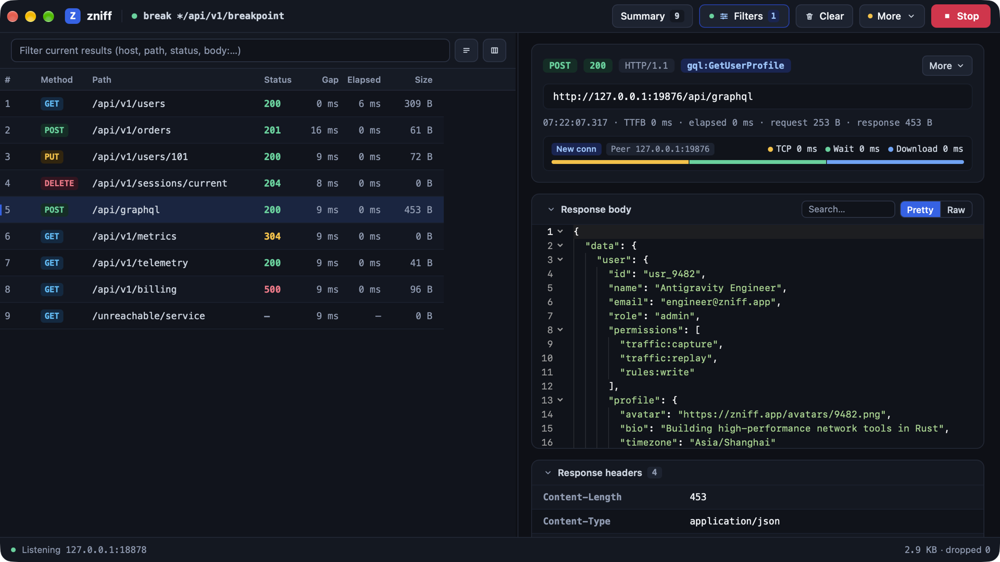
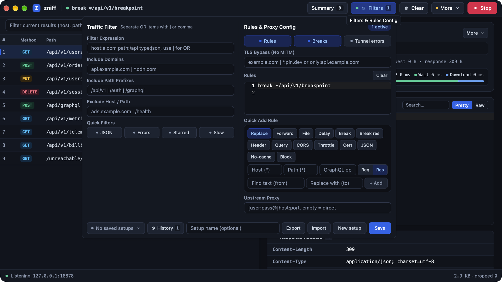
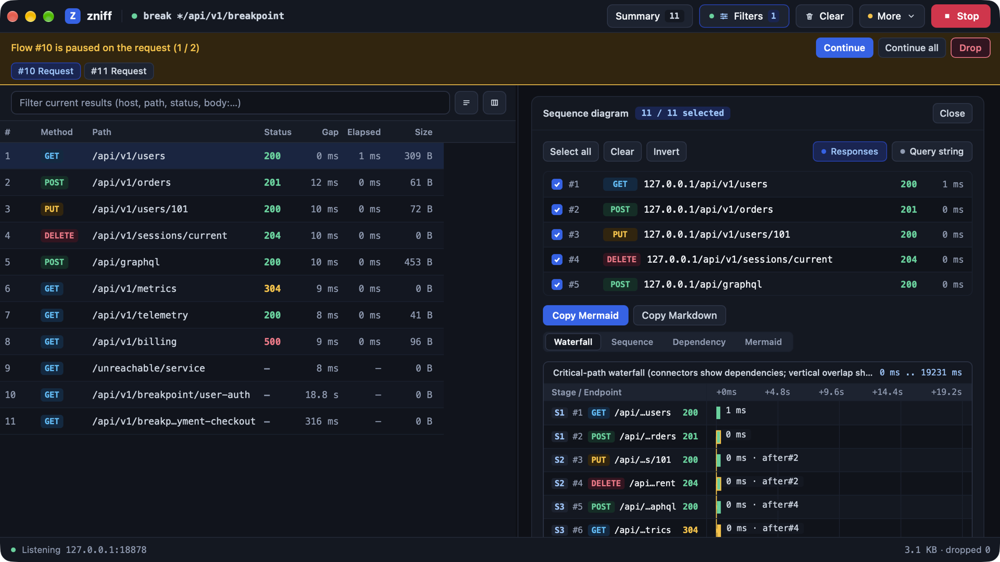
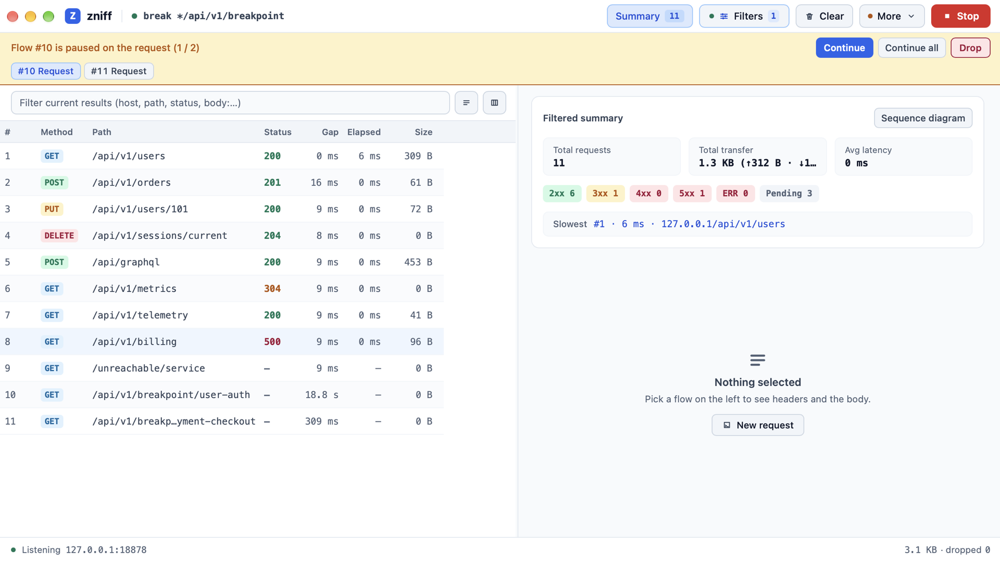

# zniff

<p align="center">
  <strong>Single-process HTTP(S) debugging proxy in pure Rust — native GUI, WebAssembly console, and built-in MCP server.</strong>
</p>

<p align="center">
  English | <a href="./README-zh.md">简体中文</a>
</p>

<p align="center">
  <a href="https://github.com/vicanso/zniff/releases"></a>
  <a href="https://www.rust-lang.org/"></a>
  <a href="./LICENSE"></a>
  <a href="#quick-start"></a>
  <a href="#cli-modes--mcp"></a>
</p>

https://github.com/user-attachments/assets/6088fb29-20fc-4b0c-a773-58b809688cef

---

## Features

- **Native & Lightweight**: Proxy engine and `nsh` GUI run in a single Rust process—no Electron, no JVM. Cold starts in **< 30 ms** and idles around **< 25 MB RAM**.
- **True Protocol Following**: Reads `ClientHello` ALPN offers and negotiates directly with origins. Supports HTTP/2 multiplexing, WebSocket frames (RFC 6455), and SSE without downgrading to HTTP/1.1.
- **Deep Inspection**: Formats JSON, GraphQL (splitting `operationName`, query, and variables), HTML/XML, schema-less Protobuf/gRPC, and MessagePack. Decodes JWTs, Unix timestamps, and Base64 inline, with baseline line-by-line Diff and body search.
- **14 Rewrite Rules & Breakpoints**: Terminal (`map-local`, `map-remote`, `break`, `break-res`, `block`) and additive (`replace`, `json`, `delay`, `throttle`, `header`, `query`, `cors`, `no-cache`, `cert`) rules, with GraphQL `op=` targeting and an 8-slot FIFO breakpoint queue.
- **Diagrams & Sharing**: Generate interactive Waterfall, Swimlane Sequence, Dependency (`flowchart TD`), and Mermaid source views. Export HAR/HTML (with optional redaction) or share live sessions via `/s/{uuid}` and `--relay`.
- **AI-Native MCP & Web Console**: Built-in JSON-RPC 2.0 MCP server (`POST /mcp` and `zniff --mcp`) plus a headless WebAssembly operator console (`zniff --web`).

---

## Screenshots

| Deep Inspection (GraphQL & JSON) | Filters & 14 Rewrite Rules |
| :---: | :---: |
|  |  |
| **Waterfall / Sequence Diagrams & Breakpoints** | **Adaptive Light & Dark Mode** |
|  |  |

---

## Quick Start

### 1. Install

**macOS**
```bash
brew install zniff
# Or build from source: make bundle
```

**Linux & Windows**
Download binaries from [GitHub Releases](https://github.com/vicanso/zniff/releases) or install via Cargo:
```bash
cargo install --path app
```

**Docker (Web Console)**
```bash
docker run --rm -p 8080:8080 -p 8877:8877 \
  -v "$PWD/zniff-data:/data" \
  vicanso/zniff-web:nightly
```
Open `http://127.0.0.1:8080` and click **Start** to bind capture port `8877`.

### 2. Configure Client & Root CA

1. Launch `zniff` (default capture address: `127.0.0.1:8877`).
2. Click **More → Copy Proxy Env** to copy terminal proxy variables:
   ```bash
   export HTTP_PROXY="http://127.0.0.1:8877"
   export HTTPS_PROXY="http://127.0.0.1:8877"
   export ALL_PROXY="http://127.0.0.1:8877"
   export SSL_CERT_FILE="$HOME/Library/Application Support/zniff/ca.crt"
   ```
3. **Trust Root CA**:
   - **macOS**: **More → Certificate → Install** to trust `zniff CA` in Keychain.
   - **iOS Simulator**: **More → Install CA to iOS Simulators** to inject the cert and proxy into all booted simulators via `xcrun simctl`.
   - **Mobile Devices**: Click **QR** in the footer or visit `http://<lan-ip>:8877/zniff`.

---

## Rewrite Rules

Rules are one per line. Multiple hosts or paths can be joined with `|` or `,`.

```text
# Terminal rules (first match wins)
map-local  api.example.com/v1/user ./mocks/user.json
map-remote api.example.com/api http://127.0.0.1:3000/api
break      api.example.com/v1/checkout
block      ads.example.com status=403

# Additive modifiers (accumulate in order)
json       api.example.com/v1 res set /data/is_vip true
delay      api.example.com/graphql 2s op=Update*
header     *.example.com res del Content-Security-Policy
```

See the full syntax and examples in **[Rules & Configuration Guide](./docs/rules.md)** ([中文指南](./docs/rules-zh.md)).

---

## CLI Modes & MCP

| Mode | Command | Description |
| :--- | :--- | :--- |
| **Desktop GUI** | `zniff` | Native desktop window with in-process proxy engine. |
| **Web Console** | `zniff --web` | Headless HTTP server (`8080`) serving the Wasm UI; capture (`8877`) starts on demand. |
| **Relay Server** | `zniff --relay --token <secret>` | Standalone relay for real-time `/s/{uuid}` session sharing. |
| **MCP Bridge** | `zniff --mcp` | Stdio bridge for AI clients (also exposed over loopback `POST /mcp`). |

<details>
<summary>Claude Desktop / Cursor MCP configuration & auth flags</summary>

```json
{
  "mcpServers": {
    "zniff": {
      "command": "zniff",
      "args": ["--mcp", "--port", "8877"]
    }
  }
}
```

Available MCP tools: `list_flows`, `get_flow_detail`, `replay_flow`, `get_rules`, `set_rules`.

| Port | Auth Type | Flag / Env |
| :--- | :--- | :--- |
| Console (`8080`) | HTTP Basic | `--web-auth <user:pass>` / `ZNIFF_WEB_AUTH` |
| Capture (`8877`) | `Proxy-Authorization` (407) | `--proxy-auth <user:pass>` / `ZNIFF_PROXY_AUTH` |
| Relay Upload | `Authorization: Bearer` | `--token <secret>` / `relay_token` |
| Relay View | HTTP Basic | `--view-auth <user:pass>` / `ZNIFF_RELAY_VIEW_AUTH` |

</details>

---

## Shortcuts, Storage & Development

| Shortcut | Action |
| :--- | :--- |
| `Cmd/Ctrl + F` | Focus filter bar |
| `Cmd/Ctrl + K` | Clear session |
| `Cmd/Ctrl + R` | Replay selected flow |
| `Cmd/Ctrl + Enter` | Send composed request / Continue breakpoint |
| `↑` / `↓` | Navigate filtered flows |
| `Esc` | Close popover or return to summary view |

**Data Directory**:
- **macOS**: `~/Library/Application Support/zniff`
- **Linux**: `$XDG_DATA_HOME/zniff` or `~/.local/share/zniff`
- **Windows**: `%APPDATA%\zniff`

Contains `config.toml`, `ca.crt` / `ca.key`, `proxy-snapshot.toml`, and `config.dev.toml` (dev mode, port `8878`). Sessions cap at 256 MB in memory, spilling unpinned bodies > 16 KB to a rotating 512 MB disk ring buffer (`zniff-spill/`).

**Build & Test**:
```bash
make dev      # Run desktop app in dev mode (port 8878)
make release  # Build release binary
make bundle   # Package macOS zniff.app
make web      # Run Web console (port 8080)
make test     # Run tests
make lint     # Run clippy
```

---

## License

[Apache License, Version 2.0](./LICENSE)
