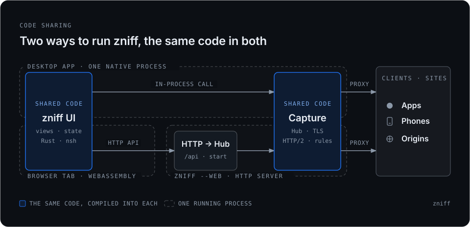

# zniff 文档索引

本目录收录 **zniff** 的使用指南、架构与行为边界说明、产品决策记录以及历史测试/审计报告。

---

## 架构概览

Desktop 与 `zniff --web` 共用同一份 Rust 界面（`nsh 0.6`）与抓包代理内核（`app/src/proxy/`）：桌面端为单进程原生应用；Web 模式将界面编为 WebAssembly 运行在浏览器中，通过 HTTP `/api` 与 `zniff --web` 进程内的 `Hub` 通信（浏览器本身不监听、不解密，也不修改系统代理）。

---

## 1. 用户指南

| 文档 | 语言 | 内容摘要 |
| :--- | :--- | :--- |
| **[规则与配置指南](./rules-zh.md)** | 简体中文 | 数据目录与配置隔离、流量过滤语法、TLS 直通名单、17 类转发/改写/扩展规则、`{{...}}` 动态模板变量与签名、本地 HTTP `hook`、`.proto` Schema 解码、上游代理与本机设置、配置预设导入导出。 |
| **[Rules & Configuration Guide](./rules.md)** | English | Complete English counterpart of the Rules & Configuration Guide. |

---

## 2. 行为边界、决策与演进

| 文档 | 定位 | 内容摘要 |
| :--- | :--- | :--- |
| **[已知限制与行为边界](./known-issues.md)** | 实时维护的权威基线 | 明确不做的边界（Non-Goals）、平台差异（macOS / Windows / Linux / Wasm）、代理与协议细节、界面/内存上限及已落地能力索引。修改代码前应以此与 `app/` 源码为准。 |
| **[产品与架构决策记录 (ADR)](./open-questions.md)** | 决策档案 | 16 项涉及交互习惯、协议语义边界与产品复杂度取舍的评估结论与落地说明。 |
| **[竞品横评与演进路线图](./competitive-gap-roadmap.md)** | 架构与规划 | 与 Proxyman / HTTP Toolkit / Reqable / mitmproxy / Charles 的能力对比、Phase 1–3b 已落地验收记录，以及 v0.4 竞品迁移与留存演进规划（Wave 1–4）。 |

---

## 3. 历史测试与审计报告（归档）

以下文档为特定历史版本的只读实机测试或审计快照，仅作演进留档，不再作为当前行为规范：

| 文档 | 基线版本 | 说明 |
| :--- | :--- | :--- |
| [功能审视与体验优化分析报告](./feature-optimization-analysis.md) | `v0.2.1` (2026-11-18) | 实机多布局审视报告；报告中的 P0 缺陷与三栏挤压问题已于 `v0.3.0+` 修复（布局统一为 `Split` 可折叠侧栏 + `TopBottom`）。 |
| [完整功能测试与 Issue 记录报告](./functional-test-issues.md) | `v0.1.0` (2026-11-13) | Milestone 1 的 56 场景端到端功能测试基线报告。 |
| [全功能与界面细节实机检视与测试报告](./test-and-ui-inspection-report.md) | `v0.1.0` (2026-11-09) | 早期 `nsh 0.4` 阶段的实机截屏与链路检视报告。 |
