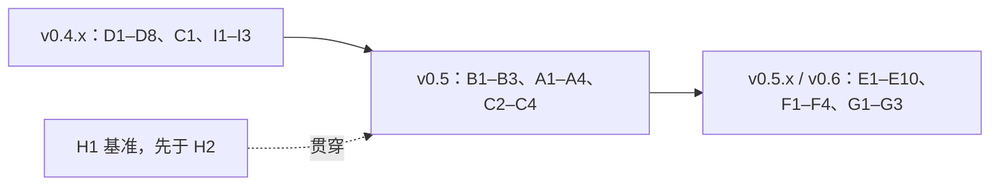

# zniff v0.5 易用性与功能增强规划

> 返回 [文档索引](./README.md) · 边界见 [已知限制与行为边界](./known-issues.md) · 架构决策见 [产品与架构决策记录](./open-questions.md#四v05-规划决策已决策待实施)

- **基线**：`v0.4.0`（`nsh 0.6.1`），2026-11-21
- **主题**：**可见与收敛**。v0.4 的能力已多于大多数同类工具，v0.5 不以堆功能为主，而是让已有能力**更好找、效果看得见、出错能自救**，再补少量高频工作流增强。
- **约束**：仍遵守 [`known-issues.md`](./known-issues.md) 第 1 节 Non-Goals（不做 HTTP/3、QUIC、透明代理、SQLite、正则、内嵌脚本运行时、重型 Postman 集合）；新增界面一律拆独立模块，不向超 1200 行的历史文件追加成块代码。
- **状态图例**：⬜ 未开始 · 🟦 已决策待实施 · ⏸ 暂缓 · ✅ 已落地

---

## 一、信息架构收敛（发现性）

| # | 项目 | 现状问题 | 建议 | 涉及模块 | 状态 |
|---|---|---|---|---|---|
| A1 | 过滤 / 规则拆分 | 「过滤」弹出层同时承载过滤、直通、规则、分组、上游与配置存取，「看什么」与「改什么」混在一起 | 「过滤」只管视图；新增独立「规则」入口（规则组、快速添加、直通、上游）；配置存取收口在预设胶囊中；顶栏胶囊分开显示 `过滤: …` 与 `规则 N 条 · M 组` | `ui/filter_panel.rs`、`ui/rules_panel.rs`、`ui/toolbar.rs`、`ui/profile_dock.rs` | ✅ ADR-17 (`179575b`) |
| A2 | 设置窗口 | 语言、字体、默认美化/树形、系统代理、证书、外部 CA、中继、认证、`allow_hosts` 分散在「更多」、底栏「安全」、底栏「接入」三处 | 新增分页「设置」窗口（通用 / 证书 / 网络与上游 / 安全 / 中继 / 更新）；`Cmd/Ctrl+,` 打开（桌面 `desktop::window()` / Wasm 模态层） | `ui/settings_window.rs`、`ui/settings_tabs.rs` | ✅ ADR-18 (`d481fac`) |
| A3 | 「更多」菜单瘦身 | 20+ 项与多行内联胶囊，`more_menu_rows.rs` 已 1074 行 | 只保留「导出 / 工具 / 帮助」三组，每组 ≤ 6 项；设置项迁往 A2 | `ui/more_menu.rs`、`ui/more_menu_rows.rs` | ✅ (`d481fac`) |
| A4 | 情境化建规则 | 规则主要靠 DSL 或快速添加表单 | 行右键与详情「更多」补「Mock 这个响应」「改这个请求头」「延迟这个接口」「屏蔽这个域名」，预填快速添加表单 | `ui/flow_quick_rules.rs`、`ui/flow_table.rs`、`ui/detail_actions.rs` | ✅ (`81febe2`) |

## 二、规则效果可视化

| # | 项目 | 建议 | 涉及模块 | 状态 |
|---|---|---|---|---|
| B1 | 流量级规则命中记录 | 基于现有 `Flow.rule_hit` 扩展记录命中明细（来源分组 + 行号 + 动词，上限 8 条）；列表行显示小标记（`✎` 改写、`↪` 转发、`⏸` 断点、`⛔` 阻断、`⏱` 延迟/限速）；详情摘要列出命中规则，点击跳到对应规则行 | `session.rs`、`proxy/hub.rs`、`rules.rs`、`ui/flow_cells.rs`、`ui/rule_badges.rs` | ✅ ADR-19 (`0f780e0`) |
| B2 | 规则行命中计数 | 规则编辑器每行显示本会话命中次数，0 次的行变灰；可用 `rule:<行号>` 过滤命中流量 | `ui/rule_assist.rs`、`ui/filter_autocomplete.rs`、`session.rs` | ✅ ADR-19 (`7789cf5`) |
| B3 | 保存前试跑 | 保存规则时用当前会话流量离线试跑，提示「将命中 N 条已有流量」或「0 条命中，检查域名」 | `rules.rs`（纯函数）、`ui/rule_dry_run.rs` | ✅ (`ca1453a`) |

## 三、出错可自救

| # | 项目 | 建议 | 涉及模块 | 状态 |
|---|---|---|---|---|
| C1 | ERR 行修复按钮 | 证书不信任或证书钉扎 → `[加入直通]` `[安装证书]` `[用隔离浏览器打开]`；源站连不上或 DNS 失败 → `[检查上游]` `[添加 resolve]`；`407` → 指向「安全」设置 | `ui/detail_summary.rs`、新增 `ui/error_actions.rs` | ✅ (`42bb92f`) |
| C2 | 批量 TLS 失败横幅 | 短时间内多条隧道失败或 `ServerHello` 后断开时，列表顶部提示「检测到 N 个应用 TLS 握手失败，可能未信任 CA」并给出一键操作 | `ui/tls_failure_banner.rs`、`ui/facet_drawer.rs`、`ui/app_shell.rs` | ✅ (`53401ff`) |
| C3 | 引导卡改为自动勾选清单 | ① 代理已监听 ② 证书已信任 ③ 收到第一条 HTTP ④ 收到第一条解密的 HTTPS；每步都显示状态，卡住的步骤给出诊断 | `ui/onboarding_checklist.rs`、`ui/onboarding_card.rs` | ✅ (`7a5a5e2`) |
| C4 | 诊断包 | 「帮助 → 导出诊断包」：脱敏后的配置、版本、平台、证书状态、最近错误摘要，便于提 issue | `diagnostics.rs`、`ui/more_menu.rs`、`ui/command_palette.rs` | ✅ (`bf2e8c5`) |

## 四、日常小摩擦（v0.4.x 小版本）

| # | 问题 | 建议 | 状态 |
|---|---|---|---|
| D1 | 过滤后列表为空只提示「Try a different filter」 | 加 `[清空过滤]` `[暂停主过滤]` 按钮，并指出是哪个过滤词把流量全滤掉了 | ✅ (`35a0c02`) |
| D2 | 30+ 过滤前缀需要记忆 | 过滤框前缀与取值自动补全（取值来自当前会话的域名、状态、应用、GraphQL op），语法错误在框内就地标红 | ✅ (`d354a41`) |
| D3 | `↑`/`↓` 换行不滚动视口 | 选中行自动滚入可见区（同步更新 `known-issues.md` 5 节） | ✅ (`3dd9c9a`) |
| D4 | 快捷键只能从命令面板发现 | `?` 或 `Cmd/Ctrl+/` 打开快捷键速查；命令面板每项显示快捷键 | ✅ (`02eecd2`) |
| D5 | `Cmd/Ctrl+K` 清空会话太容易误触 | 保留快捷键，清空后 5 秒内可撤销（Toast「已清空 N 条 · 撤销」），超时再释放内存 | ✅ ADR-20 (`ec6a899`) |
| D6 | 主题只能跟随系统 | 设置里提供 浅色 / 深色 / 跟随系统 | ✅ (`52f4bab`) |
| D7 | 界面不可缩放 | `Cmd/Ctrl` + `=` / `-` / `0` 调整界面与等宽字号，写入 `config.toml` | ✅ (`52f4bab`) |
| D8 | 中文界面下表格等宽字体回落 | 为中文环境指定中文等宽回落字体 | ✅ (`52f4bab`) |

## 五、工作流增强（新功能）

| # | 功能 | 说明 | 状态 |
|---|---|---|---|
| E1 | 内联 Mock | 详情里直接编辑响应（状态、头、正文），保存到数据目录 `mocks/` 并自动追加 `map-local`；改完立即生效，不用自己管文件 | ✅ (`dd28631`) |
| E2 | 重放后自动对比 | 重放 / 编辑重发完成后，自动把源流设为基准并打开行级对比（复用 `diff_view`） | ✅ (`1456528`) |
| E3 | 网络条件预设 | 顶栏或命令面板一键切换「3G / 弱网 / 高延迟 / 离线」，本质是内置的 `throttle` + `delay` 规则组 | ✅ (`227aef6`) |
| E4 | 规则模板库 | 快速添加旁提供常用片段：开发期 CORS、强制 500、慢接口、禁缓存、替换 baseURL、加签名头 | ✅ (`7961ecb`) |
| E5 | 会话标记 | 插入时间分隔线（如「开始测登录」），列表中显示分隔行，支持 `mark:` 过滤与导出 | ✅ (`faed85c`) |
| E6 | 匹配提醒（Watch） | 保存一个过滤表达式为提醒（如 `status:5xx host:api.x.com`），命中时发系统通知并在底栏计数 | ✅ (`2be35e3`) |
| E7 | WebSocket 帧发送 | 在已建立的 WebSocket 连接上手动注入或重发一帧（文本 / 二进制） | ⏸ ADR-21（延至 v0.6） |
| E8 | 条件断点 | 断点按 header 或正文子串匹配（`header=<k:v>` / `body=<substr>`），不引入正则，受 `1 MB` 上限约束 | ✅ ADR-21 (`b811027`) |
| E9 | 会话快照（opt-in） | 退出时可选自动保存为 HAR，下次启动询问是否恢复 | ⏸ ADR-22（暂缓，维持手动导出） |
| E10 | 导入的会话单独成标签 | 导入的 HAR / `.chlsj` 作为只读标签，与实时会话并列切换、互相对比 | ✅ ADR-22 (`b4505d7`) |

## 六、互操作与 AI

| # | 功能 | 说明 | 状态 |
|---|---|---|---|
| F1 | 更多复制格式 | HTTPie、PowerShell `Invoke-RestMethod`、JS `axios`、Kotlin `OkHttp`、Swift `URLSession` | ✅ (`3d0fbb3`) |
| F2 | 导出 API 集合 | 按当前筛选导出 Postman Collection v2.1、Bruno、`.http`（VS Code REST Client / JetBrains HTTP Client） | ✅ (`19923bb`) |
| F3 | 「复制给 AI」 | 一键生成脱敏后的 Markdown 上下文（请求、响应摘要、耗时分段、错误原因），直接贴给 LLM | ✅ (`9b8a04d`) |
| F4 | MCP 增强 | 新增 `wait_for_flow`（阻塞等待匹配流量，带超时）、`mock_flow` / `add_rule_from_flow`、`diff_flows`；补 MCP `resources`（当前筛选结果）与 `prompts`（「分析这条失败请求」） | ✅ (`9ca2980`) |

## 七、桌面与移动端接入

| # | 功能 | 说明 | 状态 |
|---|---|---|---|
| G1 | 菜单栏 / 系统托盘 | 基于 `nsh-core 0.6.1` `desktop::tray()` 提供轻量菜单（显示窗口、开始/停止、系统代理、退出）；关闭窗口驻留托盘默认关闭，在设置中按需开启 | ✅ ADR-23 (`d09f48e`) |
| G2 | Android 用户证书引导 | Android 7+ 应用默认不信任用户证书：安装页和接入中心给出 `network_security_config.xml` 片段与 debug 构建说明；模拟器可选写入系统证书 | ✅ (`f5c8269`) |
| G3 | iOS 真机分步检测 | 安装页 `/zniff` 分步提示「描述文件已安装 → 已在证书信任设置里开启」，页面回连一个 HTTPS 探测地址，成功后显示 ✓ | ✅ (`145fdb7`) |

## 八、性能与质量基线

| # | 项目 | 说明 | 状态 |
|---|---|---|---|
| H1 | 大会话基准 | 建立 1 万 / 10 万条流量下列表滚动、过滤、分面聚合的延迟与内存基线，纳入 `make bench` 和回归流程 | ✅ (`51aefc4`) |
| H2 | 过滤增量计算 | 大会话下过滤与统计改为增量更新加防抖，避免每条新流量都全量重算 | ✅ (`ec7d260`) |
| H3 | 冷启动指标 | 记录冷启动到首帧的耗时，以及自动恢复抓包所需的时间 | ✅ (`6ef8f33`) |
| H4 | 可访问性 | 键盘可达（Tab 顺序、焦点环）、高对比度主题检查 | ✅ (`1c214aa`) |

## 九、分发与对外介绍

| # | 项目 | 说明 | 状态 |
|---|---|---|---|
| I1 | 安装渠道 | Homebrew Cask、Scoop、Winget 清单，并接入 Release CI 自动更新 | ✅ (`0f6d6f8`) |
| I2 | README 与截图 | 更新 `screenshots/01`、`05` 等旧界面截图（还没有侧栏和接入中心）；Features 改成「3 个 GIF 讲清楚 3 件事」（隔离浏览器抓 HTTPS、右键 Mock、MCP 分析）；新增「从 Charles / Whistle 迁移」章节 | ✅ (`0f6d6f8`) |
| I3 | 内置演示数据 | 空会话引导卡提供「加载示例流量」，导入内置演示 HAR，还没配代理也能体验详情、规则与图表 | ✅ (`665f6b7`) |

---

## 十、建议迭代顺序

1. **v0.4.x**：第四节小摩擦、C1 ERR 修复按钮、分发与 README，改动小、见效快。
2. **v0.5**：规则命中可视化（B）和信息架构收敛（A），配合引导清单与诊断。
3. **之后**：按用户反馈挑选第五至第七节的工作流增强。
